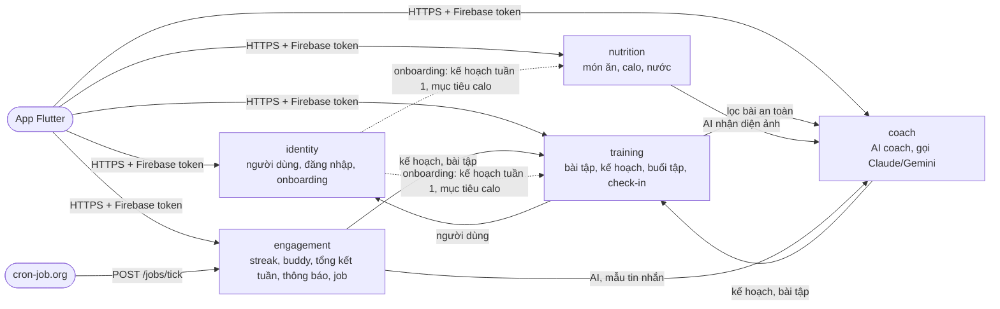

# LevelUp backend

Java 21 + Spring Boot + MongoDB. Một ứng dụng duy nhất (deploy một service trên Render), bên trong chia thành
**6 nhóm dịch vụ** như các microservice, mỗi nhóm chia **tầng** giống nhau. Mở thư mục là biết file nào làm gì.

## 1. Sáu nhóm dịch vụ



Mũi tên = nhóm này gọi nhóm kia (gọi hàm Java trong cùng ứng dụng, không qua HTTP). Hầu hết nhóm đều dùng
`identity` để lấy người dùng hiện tại; sơ đồ bỏ bớt các mũi tên đó cho dễ nhìn.

| Nhóm | Làm gì | Endpoint |
|---|---|---|
| `identity` | Xác thực Firebase token, hồ sơ, cài đặt, thiết bị nhận push, onboarding | `/me`, `/devices`, `/onboarding` |
| `training` | Thư viện bài tập, kế hoạch tuần, đổi bài / dời buổi, ghi buổi tập, check-in, số đo | `/exercises`, `/plans/*`, `/workouts`, `/checkins`, `/measurements` |
| `coach` | Chat với AI coach, AI đề xuất hành động rồi backend kiểm tra mới ghi | `/coach/messages*` (có stream) |
| `nutrition` | Tìm món, chụp ảnh món ăn tính calo, nước, tổng kết ngày | `/meals/recognize`, `/foods/search`, `/meals`, `/water`, `/nutrition/today` |
| `engagement` | Hệ thống động lực: streak tuần, lý do bỏ buổi, buddy, tổng kết tuần, **cổng gửi thông báo duy nhất**, job định kỳ | `/streak*`, `/skip-reports`, `/buddies/*`, `/reviews/*`, `/jobs/tick` |
| `shared` | Dùng chung: bảo mật/CORS, trả lỗi API, ngày theo múi giờ người dùng | — |
| `demo` | Nút giả lập cho buổi demo, chỉ bật khi `DEMO_MODE=true` | `/demo/{action}` |

## 2. Tầng trong mỗi nhóm

| Tầng | Chứa gì | Ví dụ |
|---|---|---|
| `controller/` | Nhận HTTP request, kiểm tra dữ liệu vào, gọi service. Không có logic nghiệp vụ. | `PlansController` |
| `service/` | Nghiệp vụ: đọc/ghi MongoDB, gọi nhóm khác. Bean Spring (`@Service`). | `PlanSessionService` |
| `rules/` | **Logic thuần**: hàm tính toán, không Spring, không database → dễ unit test. Quy tắc nghiệp vụ nằm ở đây. | `SessionRules`, `StreakCalculator` |
| `model/` | Document lưu trong MongoDB. | `User`, `TrainingPlan` |
| `repository/` | Interface Spring Data cho collection. | `ExerciseRepository` |
| `dto/` | `record` cho request/response của API. | `PlanView`, `WorkoutRequest` |
| `ai/` (coach) | `AiClient` và hai nhà cung cấp Claude/Gemini. Nhóm khác cần AI thì gọi qua đây. | `GeminiAiClient` |
| `notification/` (engagement) | Cổng gửi thông báo (`NotificationGateway`): giới hạn mỗi ngày, giờ yên lặng, `dedupeKey`. | `MongoNotificationGateway` |
| `config/` | Cấu hình Spring. | `SecurityConfig` |

`ArchitectureTest` (chạy cùng `./mvnw test`) giữ các luật:
- Mỗi lớp nằm đúng một nhóm và một tầng trong bảng trên.
- `rules/` và `dto/` không dùng Spring hay MongoDB.
- Không lớp nào gọi vào `controller/`.
- `model/` không phụ thuộc service/repository/controller.

## 3. Một request đi qua đâu

Ví dụ người dùng đổi bài trong buổi tập: `POST /plans/sessions/{id}/swap`

```
SecurityConfig (shared)            kiểm tra Firebase token
  → PlanSessionsController         training/controller: nhận body SwapRequest
  → CurrentUserService.require()   identity/service: lấy userId từ token (không lấy từ body)
  → ExerciseSwapService.swap()     training/service: tìm buổi của đúng userId, kiểm tra bài an toàn
      → SafeSessions               coach/rules: lọc bài theo chấn thương, dụng cụ
      → MongoTemplate              ghi training_plans
  ← PlanView                       training/dto: trả kế hoạch tuần đã cập nhật
ApiErrors (shared)                 nếu lỗi: trả {code, message} thống nhất
```

## 4. Tìm file nhanh

```
src/main/java/vn/levelup/
  LevelupBackendApplication.java
  identity/    config  controller  dto  model  repository  service
  training/    controller  dto  model  repository  rules  service
  coach/       ai  controller  dto  rules  service
  nutrition/   controller  dto  model  rules  service
  engagement/  controller  dto  notification  rules  service
  shared/      config  util  web
  demo/        DemoController  DemoService
src/test/java/vn/levelup/
  <nhóm>/<tầng>/XxxTest.java      unit test cho lớp cùng tên
  <nhóm>/XxxFlowTest.java          test cả luồng qua HTTP + MongoDB thật (FlowTestBase)
```

Thêm tính năng mới: chọn nhóm đúng nghiệp vụ, tạo `controller` + `service` + `dto`, logic tính toán để ở `rules`
(kèm unit test). Không tạo nhóm mới nếu chưa thống nhất.

## 5. Chạy

```bash
cd mongo && docker compose up -d          # MongoDB ở cổng 27018
cd backend && ./mvnw spring-boot:run       # http://localhost:8080, tài liệu API: /swagger-ui.html
./mvnw test                                # cần MongoDB đang chạy
```

Biến môi trường, deploy Render: xem `docs/deploy.md`. Quy tắc nghiệp vụ không được làm sai: `AGENTS.md`.
